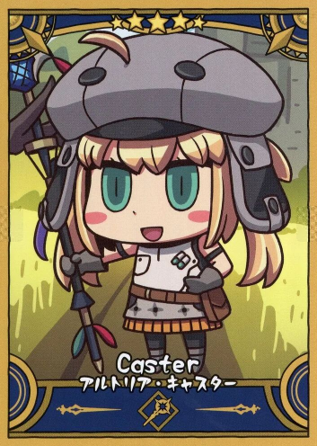

# Castoria

[](https://www.python.org/)
[](LICENSE)
[](https://github.com/Gyarahaddo/castoria/actions/workflows/ci.yml)
[](https://codecov.io/github/Gyarahaddo/castoria)

<p align="center">
  
</p>

<p align="center">
  <strong>Your Agent's Support Servant.</strong>
</p>

A collection of reusable skills designed to empower AI agents through a unified, machine-friendly CLI.

Each utility is designed to provide:
- **Agent-first design:** Tools are built with AI agent workflows in mind.
- **Structured responses:** Machine-readable JSON output for reliable integration.
- **Unified CLI:** A consistent interface for both AI agents and humans.

*Unified CLI Design*
```
castoria <utility> <action> [arguments]
```

## Available Skills

| Skill | Description |
| --- | --- |
| [youtube-music](agent-skills/youtube-music/) | Download audio from YouTube videos and save it to local storage, AWS S3, or Dropbox. |

## Setup

Some Castoria features require additional dependencies, credentials,
or external service configurations.

### Requirements

- Python 3.12+
- [uv](https://docs.astral.sh/uv/)
- FFmpeg (required for audio conversion)

### Installation

Clone the repository and install the dependencies:

```bash
git clone https://github.com/Gyarahaddo/castoria.git
cd castoria
uv sync
```

Install FFmpeg on Ubuntu.
```bash
sudo apt update
sudo apt install ffmpeg

ffmpeg -version
ffprobe -version
```

To update the CLI, dependencies, and linked skills, run the following from
the same repository root:

```bash
git pull --ff-only
uv sync
```

### Skill Installation

This installation uses Codex on Linux as sample. See the [Codex skills documentation](https://developers.openai.com/codex/skills/)
for details. For other agents, follow your agent's own skill installation
instructions using the skill folders in [`agent-skills/`](agent-skills/).

From the Castoria repository root, link the entire skill collection into
Codex's user-level skills directory:

```bash
mkdir -p "$HOME/.agents/skills"
ln -s "$(pwd)/agent-skills" "$HOME/.agents/skills/castoria"
```

Skill installation is separate from CLI installation. Make the repository's
CLI available to Codex by launching it from a terminal with the virtual
environment activated:

```bash
source .venv/bin/activate
castoria --help
codex
```

The symlink continues to use the updated skill files; no skill reinstallation
is needed. If updated or newly added skills do not appear, restart Codex.

### External Services

Some storage providers require additional credentials or service configuration.

| Provider | Configuration | Setup Guide |
| --- | --- | --- |
| AWS S3 | AWS credentials and IAM permissions. | [AWS S3 Setup](docs/setup/aws-s3.md) |
| Dropbox | Dropbox application credentials and OAuth2 refresh token. | [Dropbox Setup](docs/setup/dropbox.md) |

## License & Disclaimer

Castoria is an independent, fan-inspired open-source project and is not
affiliated with, endorsed by, or sponsored by TYPE-MOON, Aniplex, Lasengle,
or any other rights holders of Fate/Grand Order.

The source code of this project is licensed under the [MIT License](LICENSE).

The project name and character-inspired artwork are references to
Artoria Caster from Fate/Grand Order. All related characters, trademarks, and original artwork remain the property of their respective owners.
